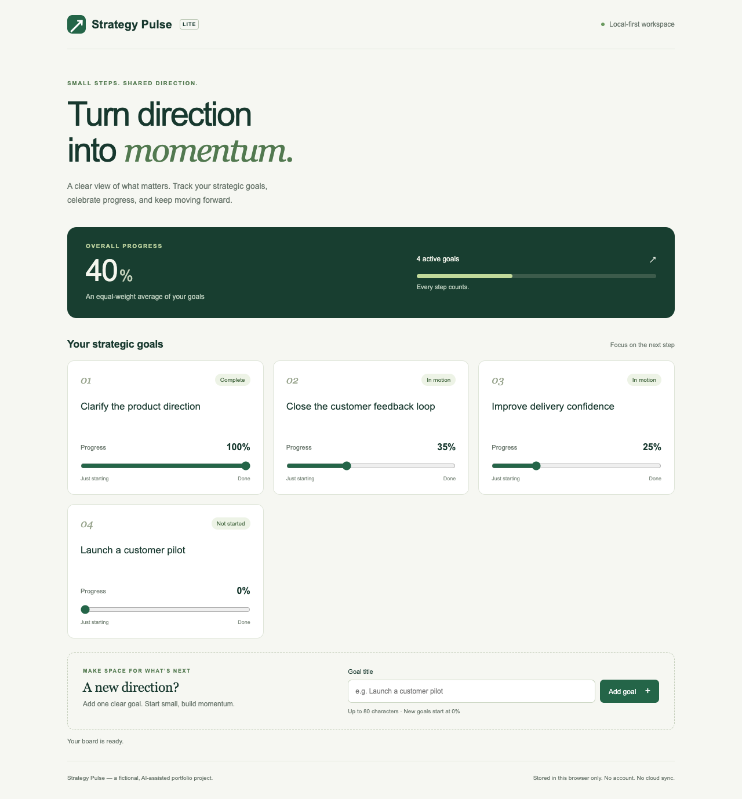
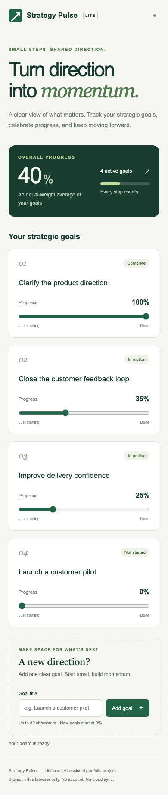

# Strategy Pulse

A fictional, local-first strategy goal tracker. Independent portfolio work: no affiliation with STRGY AI. User-approved concept and scope; implementation and current validation performed by Codex. User hands-on coding/review proficiency has not been inferred.

## Technology stack

Next.js App Router, TypeScript, React, localStorage and plain CSS. Tests use Node’s built-in test runner. No backend or database is needed.

## Screenshots

Actual local Chrome screenshots captured during Codex verification; they show a fourth goal added during the interaction check. A new board starts with three presets.



<details>
<summary>Mobile view</summary>



</details>

## Implemented

- Three preset goals; add a goal with a normalized, unique 1–80 character title.
- Integer progress from 0 to 100 with keyboard-accessible sliders.
- Equal-weight average across all goals, rounded to a whole percent. A new goal starts at zero and joins the denominator immediately.
- Versioned localStorage persistence; refresh restores added goals and progress.
- Damaged saved data is protected; an explicitly confirmed “Reset local data” removes only this app’s key and restores defaults. Cancel preserves data, and deletion failures are reported.
- Page changes and persistence have separate feedback. Failed saves warn that changes may be lost on refresh.
- Other-tab changes pause editing and saving until confirmed reload. This is lightweight conflict detection, not automatic merge or fully safe concurrent synchronization.
- Responsive English interface. Demo content only; no accounts, server APIs, paid integrations, analytics or cloud sync.

## Run locally

Node.js >=22.13 and npm are required. Dependencies are pinned in package-lock.json.

```sh
npm ci
NEXT_TELEMETRY_DISABLED=1 npm run dev -- --port 3000
```

Open http://127.0.0.1:3000 . Run commands from the project root. If Node is unavailable, install a compatible Node.js version first.

For the actual static export:

```sh
npm test
NEXT_TELEMETRY_DISABLED=1 npm run build
npm run typecheck
python3 -m http.server 3010 --bind 127.0.0.1 --directory out
```

Open http://127.0.0.1:3010 . Do not use `next start` for output:export. Storage is scoped to browser and origin: dev port 3000, preview port 3010 and a future cloud URL have different data. Clearing site data deletes the local board. External-tab changes are detected, but no automatic multi-tab merge is implemented. localStorage compare/write operations are not atomic; fully simultaneous edits can still race.

## Architecture

- `app/layout.tsx`: App Router root layout and metadata.
- `app/page.tsx`: static route, renders client dashboard.
- `app/dashboard.tsx`: React state, form, sliders, load/persist effects and accessible feedback.
- `lib/goals.ts`: typed models, pure validation/updates/averaging, versioned storage parsing and error handling.
- `app/globals.css`: local responsive styling; no external fonts or component library.
- `next.config.ts`: static export. No SSR, API routes, database or Azure SDK needed.
- `tests/goals.test.mjs`: focused Node built-in tests; no additional test runner dependency.

## Actual validation — 2026-11-09

Codex executed 19 focused tests (19 passed, including eight user-directed review regressions), Next.js production build/static export (passed), and TypeScript checking (passed). Isolated local headless Chrome exercised blank-input rejection, adding a goal, keyboard slider updates, recalculation, refresh restoration and corrupt-storage preservation. Desktop 1280px and mobile 390px screenshots were captured and visually inspected; no horizontal overflow observed. The later user-directed review also exercised reset confirmation/cancellation, injected removal/write failures and real two-tab conflict/reload behavior. These are targeted checks, not exhaustive browser/accessibility/concurrency certification.

Actual versions: {"next": "16.4.5", "react": "19.3.1", "react-dom": "19.3.1", "typescript": "5.9.3"}. The install reported zero known npm audit vulnerabilities at installation time; this is not a security certification.

See [validation summary](docs/VALIDATION.md) and [AI-assisted development record](docs/DEVELOPMENT.md). Raw local verification logs are retained privately and excluded from publication. Screenshots above are included in the proposed source release.

## Release and hosting status

Local MVP, not a deployed service. No public source URL is claimed. Azure deployment is paused because the owner currently has no usable Azure subscription. The manual Static Web Apps workflow and static hosting configuration are retained for future approval; no deployment token is configured or included.

The workflow is manual-only and defaults to build-only. It has not run on GitHub. No cloud deployment, verified Azure certificate or user-independent coding claim is made. The user confirmed browser acceptance of the three persistence-safety improvements on 2026-11-09; implementation and automated verification remain attributed to Codex.
